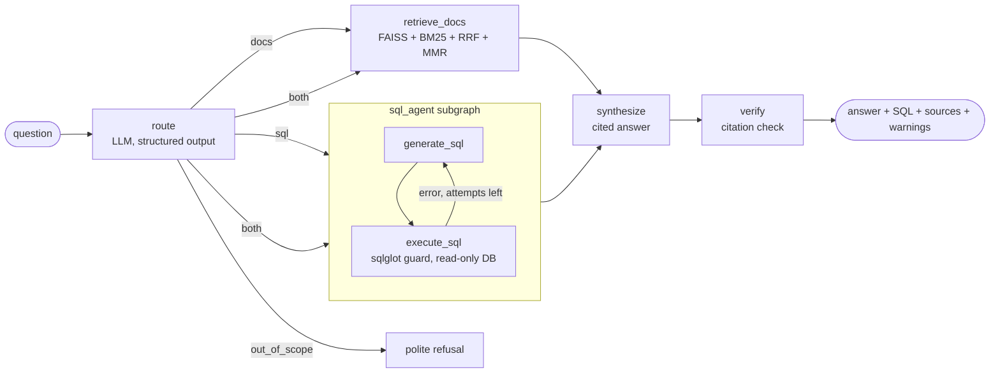

# Retail Insights Agent

An agentic analytics assistant for a (fictional) Indian grocery chain. Ask a question in plain English; a **LangGraph** agent decides whether it needs **numbers from the sales database** (text-to-SQL), **policies from business documents** (RAG), or **both**. It runs the work, then writes a short answer in which every fact cites its evidence. An **async FastAPI** service with **Redis caching** and **streaming** serves the agent.

```
Q: Did the Dairy return rate in May 2026 breach the returns policy threshold?

route: both  (SQL + documents, run in parallel)
SQL:   SELECT ROUND(100.0 * SUM(r.units) / SUM(s.units), 2) AS return_rate_pct ... LIMIT 200
docs:  [S1] returns_policy.md > Return-rate monitoring
A:     Yes. The Dairy return rate in May 2026 was 6.41% [SQL], above the 3% monthly
       threshold that requires a Quality Assurance investigation [S1].
```

## What it shows

| Area | Implementation |
|---|---|
| **Agent workflow (LangGraph)** | A router node, conditional edges and a **SQL subgraph with a self-correction loop** (errors are fed back to the LLM, up to 3 attempts). For "both" questions, the SQL subgraph and retrieval **fan out in parallel** and fan back in to one answer node. **Conversation memory** comes from a checkpointer (follow-ups are rewritten into standalone questions), and node-by-node **streaming** comes from `astream`. |
| **RAG** | Markdown-header-aware chunking with overlap, boilerplate removal and exact-duplicate removal. **Hybrid retrieval**: FAISS (cosine) + **BM25**, fused with **Reciprocal Rank Fusion**, a relevance gate that returns nothing for off-topic questions, and **MMR** to avoid near-duplicate context. |
| **LLM APIs** | OpenAI (default) or Gemini behind LangChain's `BaseChatModel`. The router and SQL steps return structured outputs parsed into Pydantic models. |
| **Text-to-SQL safety** | `sqlglot` accepts only one read-only `SELECT` over known tables and enforces a row `LIMIT`. Queries run on a **read-only connection** (SQLite `mode=ro` / Postgres `READ ONLY` + `statement_timeout`), off the event loop. |
| **Grounding check** | A deterministic `verify` node flags citations to evidence that was never retrieved, uncited answers and failed SQL. With no evidence, the agent says so instead of guessing. |
| **Backend** | Async FastAPI: request IDs, structured JSON logs, input validation, SSE streaming, background index rebuild with hot swap, 503 when no LLM key is set. |
| **Caching** | Two tiers: an in-process TTL LRU in front of **Redis**, plus a circuit breaker, so a Redis outage never fails a request. Only verified, stateless answers are cached. The cache key includes the model and index version. |
| **Concurrency** | `asyncio.gather` + `Semaphore` for API embedding calls, `asyncio.to_thread` for blocking DB and CPU work, and a **process pool** for large local-embedding jobs. The process pool is used only above a measured break-even point (see below). |
| **Quality** | 44 pytest tests (graph paths with a scripted LLM, SQL guard, RAG, cache, API), ruff, GitHub Actions CI, offline retrieval eval, cProfile benchmark, Docker Compose with Postgres + Redis. |

## Architecture



The data is a synthetic warehouse: 10 stores, 48 products, 6 promotions, ~128k daily sales lines and ~14k returns for Jan–Sep 2026. Six policy documents sit alongside it (promotions playbook, returns policy, supplier SLA, store operations, pricing and margin, Q2 business review). Patterns are planted on purpose, so that cross-source questions have real answers: a Dairy return spike in May, promotions that meet or miss the 20% uplift target, and faster growth in the South region.

## Measured results

**Retrieval** (`python -m scripts.eval_retrieval`, 24 labelled in-domain questions + 3 off-topic, k = 4, local embeddings):

| Retriever | hit@1 | hit@4 | MRR | right section @4 | off-topic rejected |
|---|---|---|---|---|---|
| Dense only (hashing embeddings + MMR) | 0.917 | 0.917 | 0.917 | 0.875 | 2 / 3 |
| **Hybrid (dense + BM25, RRF, gate, MMR)** | **1.000** | **1.000** | **1.000** | **1.000** | **3 / 3** |

The relevance-gate thresholds were tuned on this same small set, so treat these numbers as optimistic. A larger held-out set would be the next step.

**Multiprocessing break-even** (`python -m scripts.profile_ingest`, Apple M2, 4 worker processes, 1,024-dim hashing embeddings):

| Chunks | Sequential | Process pool | Speed-up |
|---|---|---|---|
| 2,000 | 0.18 s | 0.30 s | 0.6× (slower) |
| 10,000 | 0.85 s | 0.53 s | 1.6× |
| 30,000 | 2.56 s | 1.02 s | 2.5× |
| 100,000 | 8.54 s | 2.83 s | 3.0× |

Profiling changed the design twice:
1. **Lighter workers.** Worker start-up first cost ~1.5 s because each worker re-imported LangChain. Moving the hashing code into a NumPy-only module brought that down to ~0.2 s.
2. **Measured threshold.** The pool loses below a few thousand chunks, so ingestion runs inline below `PARALLEL_EMBED_MIN_CHUNKS` (default 5,000). The real 6-document corpus (31 chunks) embeds in ~1.5 ms.

**End-to-end with a real LLM:** `python -m scripts.eval_agent` runs 12 labelled questions and reports route accuracy, SQL success, answer correctness (checked against reference SQL), citation verification and latency. It needs an API key; results will be added here.

## Quickstart

```bash
python -m venv .venv && source .venv/bin/activate
pip install -e ".[dev]"
cp .env.example .env              # add OPENAI_API_KEY (or use Gemini, see the file)
python -m scripts.setup_data      # seed SQLite + build the FAISS index (also automatic on start)
uvicorn retail_agent.api.main:app --reload
```

```bash
curl -s localhost:8000/v1/ask -H 'content-type: application/json' \
  -d '{"question": "Did the Summer Chill promotion meet its uplift target?"}' | python -m json.tool

# streamed, one Server-Sent Event per graph step
curl -N localhost:8000/v1/ask/stream -H 'content-type: application/json' \
  -d '{"question": "Which region grew fastest from Q1 to Q2 2026?"}'

# conversation: reuse a thread_id for follow-ups
curl -s localhost:8000/v1/ask -H 'content-type: application/json' \
  -d '{"question": "And what was the Dairy return rate in June?", "thread_id": "demo-1"}'
```

Terminal chat: `python -m scripts.ask`. Tests: `pytest`. Everything except the live LLM calls (tests, retrieval eval, benchmarks) runs offline with no API key.

**Docker (Postgres + Redis):** `docker compose up --build`, then use `localhost:8000`. If that port is busy, start it with `API_PORT=8010`.

## API

| Method | Path | Purpose |
|---|---|---|
| `GET` | `/health` | status, index size, cache backend and hit stats, whether an LLM is configured |
| `GET` | `/v1/schema` | the schema description the SQL generator sees |
| `POST` | `/v1/ask` | `{question, thread_id?}` → answer, route, SQL, rows, sources, `verified`, warnings, `cached`, latency |
| `POST` | `/v1/ask/stream` | the same, as SSE: `step` events (route, SQL, retries, sources), then `answer` |
| `POST` | `/v1/index/rebuild` | re-ingest the documents in the background and hot-swap the index |

## Configuration

All settings are environment variables (see `retail_agent/config.py`). The most useful ones:

| Variable | Default | Meaning |
|---|---|---|
| `LLM_PROVIDER` | `openai` | `openai` or `gemini` |
| `OPENAI_MODEL` / `GEMINI_MODEL` | `gpt-4.1-mini` / `gemini-2.5-flash` | chat model |
| `EMBEDDING_PROVIDER` | `local` | `local` (offline hashing), `openai` or `gemini` (semantic) |
| `DATABASE_URL` | bundled SQLite | any SQLAlchemy URL; Postgres via `postgresql+psycopg://…` |
| `REDIS_URL` | unset | enables the shared Redis cache tier |
| `RETRIEVAL_K`, `MMR_LAMBDA` | `4`, `0.6` | context size and relevance/diversity balance |
| `MAX_SQL_ATTEMPTS` | `3` | self-correction budget |

## Design decisions

- **LangGraph rather than a single LangChain chain.** The workflow branches (sql / docs / both), loops (SQL repair), runs branches in parallel and keeps per-conversation state. A graph makes each of those explicit, testable and streamable step by step.
- **Two compiled graphs.** Stateless requests use a graph without a checkpointer, so they're cacheable and leave nothing behind. Conversations use a checkpointer keyed by `thread_id`. `InMemorySaver` is per process; production would use a Postgres or Redis checkpointer.
- **Per-turn state reset.** With memory on, the router clears last turn's SQL result and retrieved excerpts, so a follow-up never answers from stale evidence.
- **Own FAISS wrapper.** It's ~100 lines over `faiss.IndexFlatIP` and makes the vector math visible: normalisation, exact search, MMR. It persists as JSON instead of pickle, so loading an index never executes code. Exact search suits a few thousand chunks; IVF or HNSW would come in at ~10⁵–10⁶.
- **Offline-first defaults.** Hashing embeddings and a scripted test LLM keep the tests and retrieval eval free and deterministic. Switch to API embeddings for semantic search.
- **Deterministic verification over an extra LLM call.** Checking that citations point at evidence that was actually given is cheap and can't hallucinate. The cache stores only answers that pass it.

## Limitations

- All data and documents are synthetic.
- The relevance gate was calibrated on the same small labelled set used for the retrieval numbers.
- There is no authentication or per-user rate limiting on the API.
- Conversation memory is in-process (`InMemorySaver`).
- The SQL guard limits what can run. A busy database still needs its own timeouts, and they're set for SQLite (thread-level) and Postgres (`statement_timeout`).

## Project structure

```
retail_agent/
  agent/       graph.py (LangGraph: router, SQL subgraph, synthesize, verify), prompts.py
  rag/         ingest.py (chunk + embed + index), retriever.py (hybrid + MMR), store.py (FAISS),
               bm25.py, hashing.py (NumPy-only embeddings for worker processes)
  db/          models.py (schema), seed.py (synthetic data), sql_tools.py (guard + read-only runner)
  api/         main.py (FastAPI app factory, SSE, background rebuild)
  cache.py     two-tier TTL-LRU + Redis cache with circuit breaker
  bootstrap.py, config.py, llm.py, logging_setup.py, text.py
scripts/       setup_data, ask (CLI chat), eval_retrieval, eval_agent, profile_ingest
data/docs/     the six policy documents     data/eval/  labelled question sets
tests/         44 tests with a scripted LLM, no network needed
```

## License

MIT. Kestrel Retail, its data and its documents are fictional.
